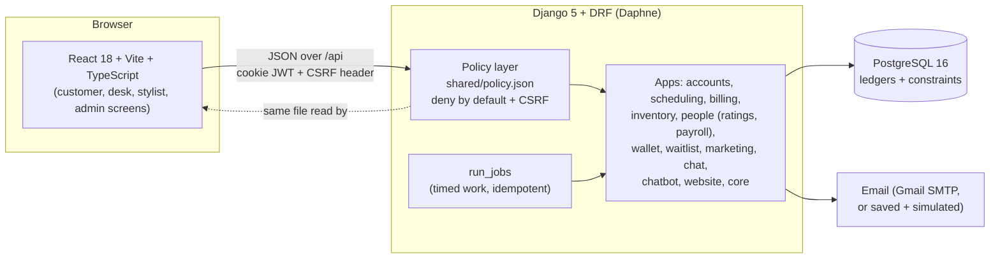

# Alankar (working name ZenFlow)

A website and management system for a unisex salon, spa and beauty parlor: public site, online
booking with payment, front-desk POS and billing, stylist day view, ratings that feed stylist pay,
stock, payroll, reports, gift cards and memberships, and a chat assistant.

- **No AI services anywhere.** The chat assistant is a deterministic rule engine (`docs/CHATBOT_ALGORITHM.md`).
- Brand names live only in `frontend/src/config/brand.ts` and `backend/core/brand.py`.
- Rules for contributors: `CLAUDE.md`. Full plan: `docs/MASTER_NOTES.md`. Build status and decisions: `docs/PROGRESS.md`.
- Security: `docs/SECURITY.md`. Backups, jobs and checks: `docs/OPERATIONS.md`.

## How it fits together



- **One permission file.** `shared/policy.json` lists every page and every API action per role
  (customer, receptionist, stylist, admin). The backend denies anything not listed; the frontend
  builds its menus and route guards from the same file.
- **Money and stock are ledgers.** A stock level, gift card balance or package session count is
  the sum of its rows; spending takes a row lock first, so two people can never spend the same last unit.
- **Every state change is written to the audit log** (admin can read it; nobody can edit it).
- **Public ids are UUIDs.** Other customers' records answer 404, never "forbidden".

## Roles

| Role | Signs in at | Lands on | Can do |
|---|---|---|---|
| Customer | `/login` (Customer tab) | `/customer-dashboard` | Book (with products), pay (coupon, gift card), cancel, rate, own invoices, chat, Shop and My Orders, Packages, Memberships |
| Receptionist | `/login` (Receptionist tab) | `/dashboard` | Confirm bookings, check in, POS billing, customers, view stock, move shop orders along, see members |
| Stylist | `/login` (Stylist tab) | `/my-day` | Own visits: start, complete; own ratings and pay estimate |
| Admin | `/login` (Admin tab) | `/dashboard` | Everything above plus staff, catalogue, stock, refunds, payroll, reports, audit log, cancel shop orders, end memberships, shop settings |

Staff never register: the admin invites them from **Staff** (the invite email shows in the dev mailbox).

## Requirements

- Python 3.11 or newer, Node.js 20 or newer, Git
- PostgreSQL 16 (Docker Desktop is the easiest way; a local install works too)
- **PostgreSQL's client tools** (`pg_dump`, `pg_restore`) on your `PATH`, for `backup_db`/`restore_db` and their
  tests. Docker's Postgres *server* image does not give you these on the host. On Windows, install
  [PostgreSQL](https://www.postgresql.org/download/windows/) (you can skip running its server) and add its `bin`
  folder to `PATH`, or set `SALON_PG_BIN` to that folder in `backend\.env`. Without them, `backup_db`/`restore_db`
  fail with a clear message, and their two tests skip instead of failing.

## Setup on Windows (cmd.exe, from the repository root)

```bat
copy .env.example .env
copy backend\.env.example backend\.env
py -c "import secrets; print(secrets.token_urlsafe(50))"
py -c "import secrets,base64;print(base64.urlsafe_b64encode(secrets.token_bytes(32)).decode())"
```

Edit both `.env` files: use the **same** database password in both, paste the first generated value
into `SALON_SECRET_KEY` and the second into `SALON_FIELD_KEY` (both in `backend\.env`). Then:

```bat
docker compose up -d db
cd backend
py -m venv .venv
.venv\Scripts\activate
python -m pip install --upgrade pip
pip install -r requirements-dev.txt
python manage.py migrate
python manage.py create_admin --email you@example.com --name "Your Name"
python manage.py seed_demo
cd ..\frontend
npm install
```

`seed_demo` fills the services, prices, team, rooms, hours, policies and FAQ (safe to run again).

**Without Docker:** install PostgreSQL 16, then in `psql` as the `postgres` user:

```sql
CREATE USER salon WITH PASSWORD 'your-password' CREATEDB;
CREATE DATABASE salon OWNER salon;
```

Put the same values in `backend\.env`. (`CREATEDB` lets the tests create their own databases.)

## Setup on Linux or macOS

```sh
cp .env.example .env && cp backend/.env.example backend/.env
python3 -c "import secrets; print(secrets.token_urlsafe(50))"        # SALON_SECRET_KEY
python3 -c "import secrets,base64;print(base64.urlsafe_b64encode(secrets.token_bytes(32)).decode())"  # SALON_FIELD_KEY
docker compose up -d db
cd backend && python3 -m venv .venv && . .venv/bin/activate
pip install -r requirements-dev.txt
python manage.py migrate && python manage.py create_admin --email you@example.com --name "Your Name"
python manage.py seed_demo
cd ../frontend && npm install
```

## Run (two terminals)

```bat
:: Terminal 1: API on http://127.0.0.1:8000
cd backend
.venv\Scripts\activate
python manage.py runserver

:: Terminal 2: website on http://localhost:5173 (proxies /api to the API)
cd frontend
npm run dev
```

- Website: http://localhost:5173
- Health check: http://127.0.0.1:8000/api/health/
- API docs (debug only): http://127.0.0.1:8000/api/docs/
- Design system and dev mailbox (debug builds only): `/design-system`, `/dev/mailbox`

## Settings (environment variables)

Set them in `backend\.env`. The file is git-ignored; **never commit it or share its values.**
`backend\.env.example` lists every name with a safe default or an empty value.

| Name | What it does |
|---|---|
| `SALON_SECRET_KEY` | Signs sessions. Required. Long and random. |
| `SALON_FIELD_KEY` | Encrypts phone numbers, notes and allergies in the database. Required. Losing it makes those fields unreadable. |
| `SALON_DEBUG` | `true` only on your own computer. Turns on the dev mailbox and API docs. Must be `false` in production. |
| `SALON_ALLOWED_HOSTS`, `SALON_CORS_ORIGINS`, `SALON_FRONTEND_URL` | Which host names and web address the API serves. |
| `SALON_DB_NAME`, `_USER`, `_PASSWORD`, `_HOST`, `_PORT` | The PostgreSQL connection. |
| `SALON_CUSTOMER_OTP` | `true` (default): customers confirm sign-in with an emailed code. |
| `SALON_IDLE_MINUTES` | Idle time before a screen locks (default 15). |
| `SALON_AUTH_RATE`, `SALON_ANON_RATE`, `SALON_USER_RATE`, `SALON_BOOKING_RATE`, `SALON_PUBLIC_WRITE_RATE` | Rate limits such as `20/min`. |
| `SALON_NUM_PROXIES`, `SALON_BEHIND_PROXY` | Set only when the API sits behind a reverse proxy you control (see `docs/SECURITY.md`). |
| `SALON_HSTS_SECONDS`, `SALON_HSTS_PRELOAD` | HTTPS-only header settings for production. |
| `SALON_API_DOCS` | Show the API docs page (default: same as debug). |
| `EMAIL_HOST`, `EMAIL_PORT`, `EMAIL_USE_TLS`, `EMAIL_HOST_USER`, `EMAIL_HOST_PASSWORD`, `DEFAULT_FROM_EMAIL` | Real email. Leave empty to keep emails simulated. |

Run `python manage.py deploy_check` before any real deployment: it lists unsafe settings.

## Demo data (a fictional salon with seven weeks of history)

```bat
cd backend
.venv\Scripts\activate
python manage.py reset_demo --yes
```

This **deletes everything in the configured database** and rebuilds it: the catalogue, six staff, six
customers, about 150 billed visits over seven weeks with ratings, a stock delivery and a low-stock alert,
cancellations and no-shows, last month's payroll (approved and paid), and some bookings waiting for today.
Everyone and everything in it is made up; all email addresses end in `demo.example.com`, a domain that
cannot reach a real person. While the demo is being built no email is sent for real. Afterwards, if you set up real Gmail, a booking you make as a demo customer would try to email that address, so keep real email off while demoing.

To make accidents hard, the command refuses unless you pass `--yes` **and** the database name contains
`demo` (for example `SALON_DB_NAME=salon_demo`). To reset a differently named database, add
`--really-wipe <that database name>`. Add `--no-history` for just the catalogue and the accounts.

| Role | Email | Notes |
|---|---|---|
| Admin | `owner@demo.example.com` | |
| Receptionist | `reception@demo.example.com`, `reception2@demo.example.com` | |
| Stylist | `rahul@demo.example.com`, `kiran@demo.example.com`, `priya@demo.example.com` | Different rating levels, so pay differs |
| Customer | `meera@`, `vikram@`, `anita@`, `sameer@demo.example.com` | Have history; may be asked to rate a recent visit before booking online |
| Customer | `divya@`, `karthik@demo.example.com` | New: use them to try online booking (karthik has a pending request, divya a held slot) |

Password for every demo login: `Demo-Pass-2026!` (fictional accounts only; never use it anywhere real).
Run the command again any time to go back to the start.

## Checks and tests

```bat
:: Backend (venv active, database running)
cd backend
pytest
ruff check .
ruff format --check .

:: Frontend
cd frontend
npm test
npm run lint
npm run typecheck
npm run format:check
npm run build
```

Backend tests use their own temporary database. Every role has an "allowed" and a "denied" test for each
action; there are also tests for double-spending races, query counts, database constraints and log hygiene.

### Browser tests (end to end)

First time only (downloads a test browser, about 150 MB):

```bat
cd frontend
npm install
npx playwright install chromium
```

Then, **from the repository root** (not from inside `backend` or `frontend` — `scripts\` is a folder at the top level, so `cd ..` first if you're in either), one command:

```bat
scripts\e2e.cmd
```

(Linux/macOS: `sh scripts/e2e.sh`.) It starts its own API and website on ports 8001 and 5174 using a
throw-away database named `alankar_e2e` (it refuses any database whose name does not end in `_e2e`), runs
everything, and stops them. Your real data is never touched. It runs:

- `full-workflow`: four signed-in browsers (customer, receptionist, stylist, admin) plus a second customer. Booking,
  confirmation, online payment, check-in rules, stylist service, POS bill with a retail item, double-billing refused,
  stock down by one, rating, admin audit log / ratings / reports / payroll, paid cancellation with refund, logout.
  It also tries things each role must **not** be able to do, in the page and in the API.
- `basic-a11y` and `axe`: accessibility checks on public pages and on each role's main screens.
- `mobile`: every main screen at phone width (375 px) must not scroll sideways.

Add `--headed` to watch it. After a failure, `npm run e2e:report` (in `frontend`) opens a report with screenshots and a trace.

### Dependency audit (needs internet)

From the repository root:

```bat
scripts\audit.cmd
```

Findings and what was/wasn't fixed are in `docs/SECURITY.md` under "Dependency audit".

## Real email (Gmail, about 5 minutes)

Without this, emails are saved and shown on the dev mailbox. With it, invites, reset links, payment links
and receipts are sent for real (a copy is still saved).

1. On your Google account, turn on **2-Step Verification**.
2. In your Google Account security settings, search for **App passwords** and create one named "Alankar".
   You get a 16-character password. Never use your normal Google password.
3. Put these in `backend\.env`:

   ```
   EMAIL_HOST=smtp.gmail.com
   EMAIL_PORT=587
   EMAIL_USE_TLS=true
   EMAIL_HOST_USER=your-gmail@gmail.com
   EMAIL_HOST_PASSWORD=the-16-character-app-password
   DEFAULT_FROM_EMAIL=Alankar <your-gmail@gmail.com>
   ```

4. Restart the API and test: `python manage.py send_test_email --to some-other-email@gmail.com`.

Gmail allows roughly 500 emails a day, enough for a demo; for a real launch use a dedicated email service
(only these settings change). If sending fails, the invite stays valid and the admin can copy the link or resend.
If you paste a log anywhere, remove the lines with passwords first.

## Daily operations

- `python manage.py run_jobs` does all timed work (expired holds, waitlist, memberships, campaigns,
  rating reminders, old token clean-up). Safe to run twice. Schedule it every 5 minutes.
- `python manage.py backup_db` / `restore_db` (restores only into a **new** database) and
  `python manage.py check_integrity` (read-only consistency check): see `docs/OPERATIONS.md`.

## Security summary

Details and the list of problems found and fixed are in `docs/SECURITY.md`.

- Deny-by-default policy file, enforced on the server for every endpoint; CSRF is checked first, even on public writes.
- Sessions are cookie-based (HttpOnly) with refresh rotation; a password change ends old sessions at once.
  Per-email sign-in lockout and rate limits on sign-in, booking and public forms.
- Staff invites and reset links are hashed, expire and work once; they are race-safe.
- The API is JSON only, sends a strict content security policy and `no-store`, and limits request size.
- Phone numbers, notes and allergies are encrypted in the database. Logs are scrubbed of secrets and personal details.
- Admin cannot read customer chats. Every state change is in the audit log.

## Troubleshooting

### "password authentication failed for user salon" when the backend test suite tears down

Seen on Windows with `pytest -q`, alongside this warning right before it:

```
RuntimeWarning: Django was unable to create a connection to the 'postgres' database and will use
the first PostgreSQL database instead.
PytestWarning: Error when trying to teardown test databases: OperationalError('connection failed:
... FATAL: password authentication failed for user "salon"')
```

These are two separate things, both caused by the Docker Postgres container's state not matching
the current `.env` files:

1. **The warning is expected and harmless.** `docker-compose.yml` sets `POSTGRES_DB=salon`, so on
   first start the official `postgres` image creates only the `salon` database — it does **not**
   also create the default `postgres` maintenance database. Django's test runner needs to connect
   to a database other than the one it is about to drop, tries `postgres` first, finds it missing,
   and falls back to using `salon` for that one administrative connection. Nothing is lost or
   broken; this is just cosmetic log noise.
2. **The password failure is real** and happens because `POSTGRES_PASSWORD` (and `POSTGRES_USER`)
   are only applied by the `postgres` image the *first* time it initializes an empty data
   volume. If the `salon-db-data` Docker volume was created before you set (or last changed) the
   password in `.env` / `backend\.env`, the running database still has the **old** password baked
   in, even though both `.env` files now agree with each other. The same mismatch, separately, can
   also mean the `salon` role was never granted `CREATEDB`, which pytest needs to create and drop
   its own test database.

**Safe fix (does not touch your data, your volume, or any table):** from the repository root, with
the `db` container running (`docker compose up -d db`):

```bat
docker compose exec db psql -U salon -d salon -c "ALTER USER salon WITH PASSWORD 'the-same-password-as-in-your-.env-files' CREATEDB;"
```

Run it exactly as shown, with your own `SALON_DB_PASSWORD` value in place of the placeholder (it
must be the value currently in both `.env` and `backend\.env` — they should already match each
other). This connects to the container over its internal Unix socket as `salon` without needing a
password (the image trusts local connections for administration), and resets the live role's
password and privileges to match what your `.env` files say, whatever the volume's password
currently is. No `docker compose down -v`, no dropped database, no lost bookings or seed data.

To also make the "postgres database" warning go away (optional, cosmetic only):

```bat
docker compose exec db psql -U salon -d salon -c "CREATE DATABASE postgres;"
```

**Before running either command, verify what's actually wrong** rather than guessing:

```bat
docker compose exec -e PGPASSWORD=the-same-password-as-in-your-.env-files db psql -U salon -d salon -c "SELECT 1;"
docker compose exec -e PGPASSWORD=the-same-password-as-in-your-.env-files db psql -U salon -d salon -c "\du salon"
```

The first fails with "password authentication failed" if the volume's password is indeed stale
(confirming the fix above is needed); the second shows whether `salon` already has `Createdb` in
its role attributes. If the first command actually **succeeds**, the password itself is fine and
something else is going on (for example two different Postgres servers both listening on port
55432) — stop and look further rather than applying the fix blind.

If you ever do need a clean slate (not required for this issue): `docker compose down -v` deletes
the `salon-db-data` volume and all data in it, including every booking, customer and staff record
you've created. Never run this without confirming first.

## Online shop, coupons, products with a visit, memberships (Task 8.5)

- **Shop** (customer menu): products marked "Sold in the online shop" in Admin > Inventory are
  listed with their description. Prices, GST, coupon, membership discount and delivery are always
  worked out by the server. Placing an order holds the stock; an unpaid order expires after the
  "time to pay" in Admin > Settings > Online shop and the stock goes back.
- **Orders** (receptionist and admin menu): filter by status, search, date range; mark packed,
  hand to delivery (with a courier note), mark delivered. Only the admin cancels, with a reason;
  everything paid is refunded and the stock goes back.
- **Coupons** work at the shop checkout and on the booking payment page. Online, the order is
  items, coupon, membership, package, delivery, gift card last. A coupon used online for a booking
  is carried to the counter so the bill matches what was paid.
- **Products with a visit**: Admin > Services > Categories > "Recommended products" decides what
  the booking sheet offers. Products picked there are paid online with the booking; "Add to my
  next appointment" in the Shop adds pay-at-the-salon items. Either way the stock is held and the
  POS bills them once.
- **Memberships** (customer menu): renew (also takes back a cancellation), cancel, buy again after
  it ends. Admin > Memberships can end one early with a reason.

## Known limitations

- Anyone can lock another person's account for 15 minutes by typing wrong passwords for that email; the owner can unlock it.
- A refresh token used twice is refused, but this does not sign the real user out everywhere.
- Rate limits and live chat use memory inside one server process. Use one process, or add Redis first.
- The staff invite check carries its token in the web address; our logs hide it, but a proxy might log it.
- Overlapping bookings are prevented by row locks and checked by `check_integrity`, not by a database constraint.
- Payments use a **mock gateway**; no real money moves. A real gateway is not integrated.
- Browser tests that book "today" cannot run in the last ~30 minutes before midnight (shop time, Asia/Kolkata).
- Deployment (HTTPS, reverse proxy, scheduled backups) is not set up yet: this is Task 12.
- The shop delivers only (no "collect at the salon"); delivery has no courier integration, staff
  type the courier and tracking number by hand.
- The counter (POS) keeps its own discount order (membership before coupon), which can differ by
  a few rupees from the online order for a flat coupon combined with a membership.
